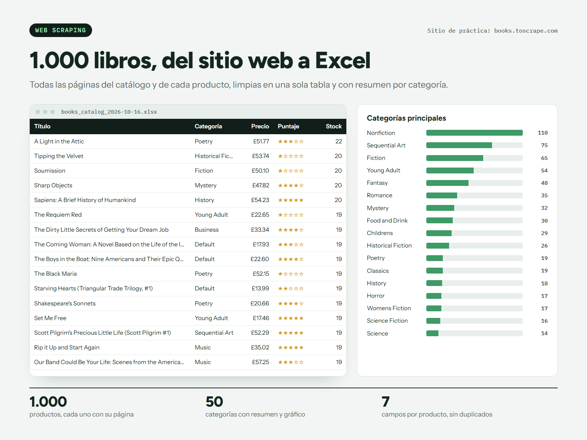

# Scraping de 1000 productos a Excel

[](https://github.com/nandres/scraping-catalogo-excel/actions/workflows/ci.yml)

Muestra de trabajo. Un scraper en Python recorre las 50 páginas de un catálogo, entra a cada uno de los 1000 productos y entrega un Excel listo para filtrar, con los mismos datos en CSV.



Está hecho sobre [books.toscrape.com](https://books.toscrape.com), un sitio público pensado para practicar scraping.

## Qué entrega

- **Datos de cada producto:** título, categoría, precio, puntaje, stock, código y enlace.
- **Excel** con filtros y una hoja de resumen por categoría que se recalcula sola, con gráfico.
- **CSV** con los mismos datos, que abre bien en Excel con tildes y eñes.
- **Ritmo moderado** para no cargar el sitio, con reintentos si una página falla.

El resultado de ejemplo está en [`entregable/`](entregable).

## Correrlo

Requiere Python 3.11 o superior.

```bash
pip install -r requirements.txt
python scraper.py
```

Tarda varios minutos, porque visita más de 1000 páginas con pausas. El CI comprueba que el script cargue con sus dependencias, sin consultar el sitio.

## Licencia

Software propietario: ver [LICENSE](LICENSE).

Hecho por **Marcos Arellano** · [marcos-arellano.vercel.app](https://marcos-arellano.vercel.app)
